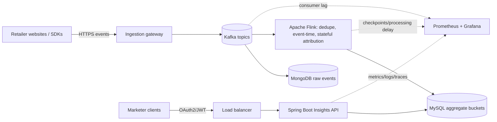

# Retail Insights Streaming Platform

## Architecture

## Flow
1. Website emits `eventId`, `tenantId`, `campaignId`, `eventType`, `eventTime`, and an available customer/session/browser ID.
2. Gateway validates schema/source and publishes to Kafka.
3. Independent consumers persist raw events and process events with Flink.
4. Flink deduplicates by stable event ID, uses event time, maintains recoverable state, and correlates clicks with basket additions under an attribution window.
5. Flink idempotently updates hourly/daily aggregate buckets in MySQL.
6. Spring Boot validates caller/tenant permissions and queries indexed aggregate buckets.

## API
`GET /ad/{campaignId}/clicks?startTime=2026-10-25T00:00:00Z&endTime=2026-10-27T00:00:00Z`
Also supports `impressions` and `clickToBasket`. Time range is `[startTime, endTime)` in UTC. The demo uses `X-Tenant-Id`; production must derive tenant identity from a validated JWT/OAuth2 claim, not trust a caller-controlled header.

## Technology rationale
- Kafka: high-throughput buffer, decoupling, replay within retention.
- Flink: continuous stateful processing, event-time handling, checkpoints/recovery.
- MongoDB: flexible raw event documents; consider object storage for cheaper long-term archive.
- MySQL: simple indexed aggregate queries; reassess if throughput/cardinality exceeds capacity.
- Spring Boot: Java REST API, validation and testable service layers.
- Prometheus/Grafana: metrics and dashboards. Centralized structured logs/traces and alerts complement them.
- Docker for reproducible packaging; Kubernetes for orchestration when scale warrants it.

## Cross-cutting concerns
- Security: OAuth2/JWT, tenant authorization on every query, least privilege, TLS, encryption at rest, secrets management, audit logging.
- Resilience: Kafka replication/retention; Flink checkpoints; idempotent aggregate updates; retry/backoff and dead-letter handling for invalid events.
- Monitoring: API p95/p99 latency, error rate, throughput, DB query latency, Kafka consumer lag, event processing delay, checkpoint failures, rejected events, CPU/memory, storage growth.
- Scaling: Kafka partitions, Flink parallelism, stateless API replicas behind a load balancer, indexed aggregates; bottlenecks depend on partition count and downstream capacity.
- Retention/privacy: TTL/retention for raw events, archival, deletion/correction across raw events, state, aggregates, caches and backups per policy.
- Cost: tenant-level usage, retention tiers, right-sizing, capacity and storage growth alerts.

Design Decisions and Trade-offs
1. Kafka — Event Ingestion
Why: Decouples event producers from consumers and buffers traffic spikes.

Benefit: Consumers can recover from temporary failures by replaying retained events.

Trade-off: Adds infrastructure and operational complexity.

2. Apache Flink — Stream Processing
Why: Supports stateful processing, event-time windows, and click-to-basket attribution.

Benefit: Enables continuous metric computation with low latency.

Trade-off: State management, checkpointing, and late-event handling require careful configuration.

3. MongoDB — Raw Event Storage
Why: Provides flexible storage for raw event records.

Benefit: Supports historical analysis and investigation.

Trade-off: Long-term storage at very high volumes may be more economical in object storage.

4. MySQL — Aggregated Insights
Why: Stores pre-calculated campaign metrics for API queries.

Benefit: Avoids scanning large volumes of raw events for every request.

Trade-off: Requires suitable indexes and an approach for updating aggregates when events are duplicated or arrive late.

5. Pre-aggregation vs. Query-time Computation
Decision: Calculate metrics continuously and store aggregates in MySQL.

Benefit: Improves API response time and reduces repeated computation.

Trade-off: Adds processing complexity to maintain accurate aggregates.

6. Accuracy vs. Latency
Decision: Use event-time processing and define a policy for late-arriving events.

Benefit: Produces more reliable metrics when events arrive out of order.

Trade-off: Some metrics may be corrected after their initial publication.

7. Scalability vs. Cost
Decision: Scale ingestion, processing, and API services independently.

Benefit: Capacity can be added where workload demands it.

Trade-off: Partition counts, processing parallelism, storage retention, and infrastructure costs require ongoing monitoring.

## Run
Requires Java 17+ and Maven: `mvn spring-boot:run`
The implemented slice is a runnable API demo with seeded in-memory aggregate data. It does not connect to Kafka, Flink, MongoDB or MySQL; those are represented in the proposed architecture.
