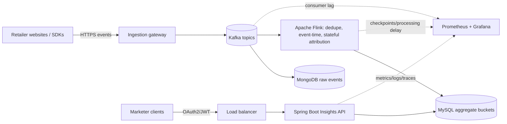

# Retail Insights Streaming Platform

## Architecture

## Flow
1. Website emits `eventId`, `tenantId`, `campaignId`, `eventType`, `eventTime`, and an available customer/session/browser ID.
2. Gateway validates schema/source and publishes to Kafka.
3. Independent consumers persist raw events and process events with Flink.
4. Flink deduplicates by stable event ID, uses event time, maintains recoverable state, and correlates clicks with basket additions under an attribution window.
5. Flink idempotently updates hourly/daily aggregate buckets in MySQL.
6. Spring Boot validates caller/tenant permissions and queries indexed aggregate buckets.

## API
`GET /ad/{campaignId}/clicks?startTime=2026-10-25T00:00:00Z&endTime=2026-10-27T00:00:00Z`
Also supports `impressions` and `clickToBasket`. Time range is `[startTime, endTime)` in UTC. The demo uses `X-Tenant-Id`; production must derive tenant identity from a validated JWT/OAuth2 claim, not trust a caller-controlled header.

## Technology rationale
- Kafka: high-throughput buffer, decoupling, replay within retention.
- Flink: continuous stateful processing, event-time handling, checkpoints/recovery.
- MongoDB: flexible raw event documents; consider object storage for cheaper long-term archive.
- MySQL: simple indexed aggregate queries; reassess if throughput/cardinality exceeds capacity.
- Spring Boot: Java REST API, validation and testable service layers.
- Prometheus/Grafana: metrics and dashboards. Centralized structured logs/traces and alerts complement them.
- Docker for reproducible packaging; Kubernetes for orchestration when scale warrants it.

## Cross-cutting concerns
- Security: OAuth2/JWT, tenant authorization on every query, least privilege, TLS, encryption at rest, secrets management, audit logging.
- Resilience: Kafka replication/retention; Flink checkpoints; idempotent aggregate updates; retry/backoff and dead-letter handling for invalid events.
- Monitoring: API p95/p99 latency, error rate, throughput, DB query latency, Kafka consumer lag, event processing delay, checkpoint failures, rejected events, CPU/memory, storage growth.
- Scaling: Kafka partitions, Flink parallelism, stateless API replicas behind a load balancer, indexed aggregates; bottlenecks depend on partition count and downstream capacity.
- Retention/privacy: TTL/retention for raw events, archival, deletion/correction across raw events, state, aggregates, caches and backups per policy.
- Cost: tenant-level usage, retention tiers, right-sizing, capacity and storage growth alerts.

## Trade-offs
- Real-time freshness vs completeness: delayed events may correct earlier event-time buckets.
- Unique customers vs event counts: define metric semantics; distinct counting requires identity/window strategy.
- Cross-device attribution only works when a permitted identity link exists.
- Exactly-once end-to-end behavior is not automatic; combine stable event IDs, checkpoints, idempotent sinks and reconciliation.

## Run
Requires Java 17+ and Maven: `mvn spring-boot:run`
The implemented slice is a runnable API demo with seeded in-memory aggregate data. It does not connect to Kafka, Flink, MongoDB or MySQL; those are represented in the proposed architecture.
